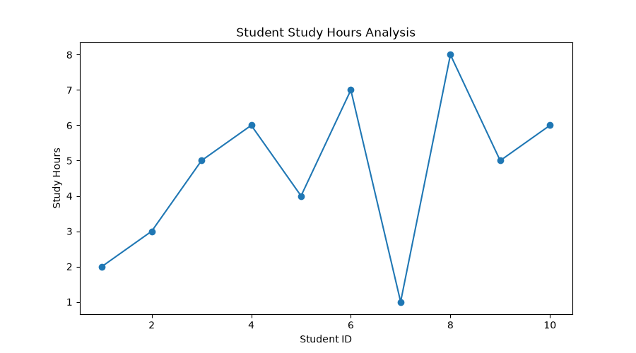
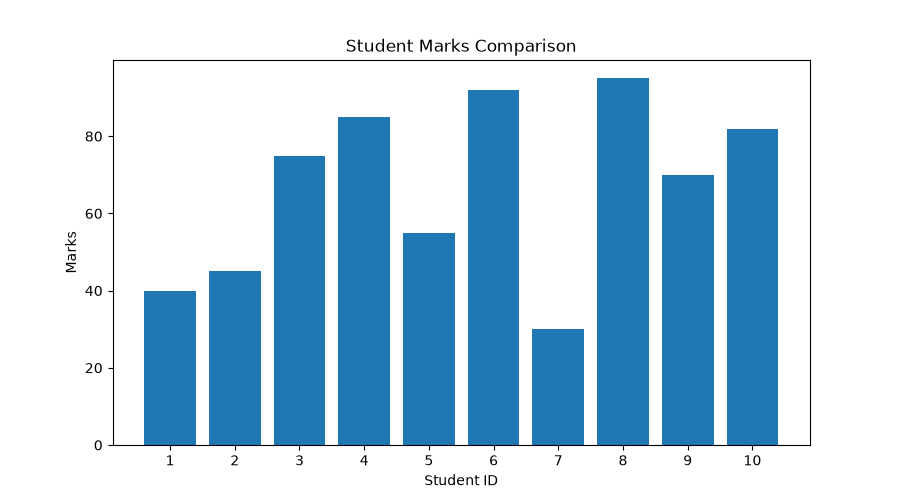
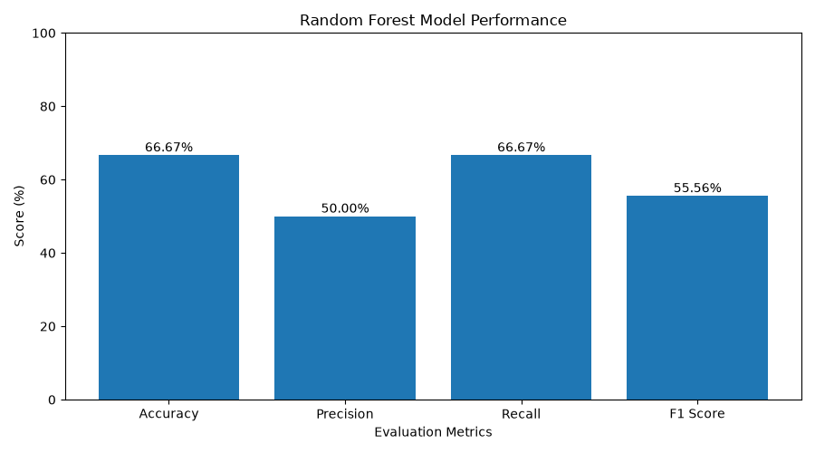

# 🎓 Student Study Habit Analyzer Using Machine Learning

[](https://www.python.org/)
[](https://scikit-learn.org/)
[](https://pandas.pydata.org/)
[](https://numpy.org/)
[](https://matplotlib.org/)
[](LICENSE)

An intelligent Python-based mini-project designed to analyze student study habits, evaluate academic patterns, and predict student performance using **Machine Learning (Random Forest Classifier)** and data analytics visualizations.

---

## 📌 Project Overview

Academic success is significantly influenced by daily study routines, sleeping hours, and classroom attendance. **Student Study Habit Analyzer** provides an end-to-end framework to:
- Collect and manage student academic and habit metrics.
- Train and evaluate a Machine Learning classification model with performance metrics (Accuracy, Precision, Recall, F1-Score).
- Predict student academic performance categories with probability confidence scores.
- Generate visual analytical charts to compare study hours, attendance, and marks.

---

## 🚀 Key Features

- **🤖 Machine Learning Model Training:** Trains a **Random Forest Classifier** with automated train-test splitting and detailed classification metrics.
- **🔮 Real-Time Student Predictor:** Predicts student performance category (`Good`, `Average`, `Needs Improvement`) along with probability distributions based on daily study hours, sleep hours, and attendance.
- **📊 Analytics Dashboard & Visualizations:** Computes batch statistics (average marks, study hours, attendance, top-performing student) and exports graphical charts (`.png`).
- **🗂️ Student Database Management:** Easily add new student records with real-time input validation and inspect all records in clean tabular CLI views.
- **💻 Interactive CLI Menu:** Clean, user-friendly interactive terminal navigation.

---

## 🧠 Machine Learning Architecture

### 1. Feature Representation
| Feature | Type | Description |
| :--- | :--- | :--- |
| `Study_Hours` | Numerical (Float) | Daily study time in hours (0 - 24) |
| `Sleep_Hours` | Numerical (Float) | Daily sleeping time in hours (0 - 24) |
| `Attendance` | Numerical (Float) | Student attendance percentage (0 - 100%) |

### 2. Target Performance Classification
The student performance is classified into three categories based on marks:
- **Good:** Marks $\ge$ 75
- **Average:** 50 $\le$ Marks $<$ 75
- **Needs Improvement:** Marks $<$ 50

### 3. Model & Evaluation
- **Algorithm:** Random Forest Classifier (`n_estimators=100`, `random_state=42`)
- **Evaluation Metrics:**
  - Accuracy Score
  - Weighted Precision & Recall
  - Weighted F1-Score
  - Per-category support & classification report

---

## 📊 Visualizations

The system automatically generates comparative analytical plots saved directly in the project directory:

| Study Hours Analysis | Student Marks Comparison | ML Accuracy & Metrics |
| :---: | :---: | :---: |
|  |  |  |

---

## 📁 Project Structure

```text
mini_project_student_study/
├── main.py                  # Main CLI entry point & menu controller
├── ml_model.py              # Machine learning training & evaluation pipeline
├── predict_student.py       # Performance prediction with confidence scores
├── analytics.py             # Statistical calculations & chart generators
├── add_student.py           # Add new student records with validation
├── all_students.py          # View all records formatted in tabular grids
├── student_data.csv         # Persistent CSV dataset storage
├── requirements.txt         # Project dependencies
├── .gitignore               # Git ignore rules
├── marks_chart.png          # Generated student marks chart
├── study_hours_chart.png    # Generated student study hours chart
├── ml_accuracy_chart.png    # Generated model evaluation chart
└── README.md                # Project documentation
```

---

## 🛠️ Tech Stack & Libraries

- **Language:** Python 3.8+
- **Machine Learning:** Scikit-Learn
- **Data Manipulation:** Pandas, NumPy
- **Data Visualization:** Matplotlib
- **CLI Formatting:** Tabulate

---

## ⚡ Installation & Setup

### 1. Clone the Repository
```bash
git clone https://github.com/ashishpandey1582003-arch/mini_project_student_study.git
cd mini_project_student_study
```

### 2. Set Up Virtual Environment (Recommended)
```bash
# Windows
python -m venv venv
venv\Scripts\activate

# macOS / Linux
python3 -m venv venv
source venv/bin/activate
```

### 3. Install Dependencies
```bash
pip install -r requirements.txt
```

---

## 🎯 How to Run

Launch the interactive CLI system:
```bash
python main.py
```

### Main Menu Options:
```text
======================================
     STUDENT STUDY HABIT ANALYZER
======================================

========== MAIN MENU ==========
1. Train Machine Learning Model
2. Predict Student Performance
3. View Analytics Dashboard
4. View All Students
5. Add New Student
6. Exit
```

---

## 🔮 Future Scope

- [ ] Web-based GUI using Streamlit or Flask.
- [ ] Incorporating extracurricular activities, screen time, and stress levels.
- [ ] Automated PDF performance report generation for students and educators.
- [ ] Integration with cloud databases (Firebase, SQLite, PostgreSQL).

---

## 👤 Author

- **Ashish Pandey**
- GitHub: [@ashishpandey1582003-arch](https://github.com/ashishpandey1582003-arch)
- Email: [ashishpandey1582003@gmail.com](mailto:ashishpandey1582003@gmail.com)

---

## 📄 License

This project is licensed under the [MIT License](LICENSE) - feel free to use and modify for learning and development purposes.
